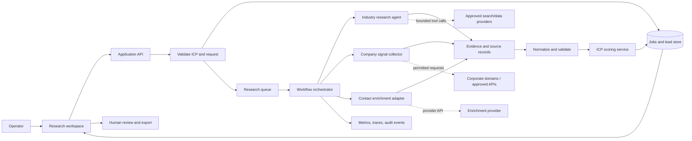

# Multi-Agent Enterprise Market & Lead Intelligence Engine

An intended platform for researching target industries, gathering permitted corporate-domain signals, enriching business contacts, and ranking candidate leads against a configurable Ideal Customer Profile (ICP).

> **Status:** Local MVP implemented. The running behavior is described under “MVP behavior”; the broader multi-agent components below remain a proposed direction.

## Goals

- Turn an ICP and target market into traceable, reviewable lead candidates.
- Separate research, signal collection, enrichment, and scoring so each can be validated independently.
- Preserve source, timestamp, confidence, and processing history for derived facts.
- Support human review before export or other consequential actions.

## MVP behavior

The FastAPI application accepts an ICP and operator-supplied candidate records, validates input, deduplicates companies by domain, computes a deterministic rule score with reasons, stores each result in SQLite, and serves a small JSON-input web page. It does not crawl sites, autonomously research markets, find contacts, or call enrichment services. See [`docs/DEPLOYMENT.md`](docs/DEPLOYMENT.md) for setup and the current security limitations.

## Proposed workflow

## Proposed future component responsibilities

- **Research workspace:** Accept ICP criteria, show job progress, evidence, score explanations, and review actions.
- **Application API:** Authenticate users, authorize access, validate requests, create jobs, and expose status/results.
- **Workflow orchestrator:** Schedule bounded stages, enforce timeouts and retry policies, and persist state transitions. It should not treat agent prose as trusted structured data.
- **Research agent:** Produce candidate market/company findings with citations or source references, not unsupported facts.
- **Signal collector:** Use explicitly approved APIs or permitted public endpoints, honoring robots/terms and provider limits; normalize observed signals with provenance.
- **Enrichment adapter:** Isolate provider-specific schemas, credentials, limits, and errors. Avoid collecting fields beyond the configured purpose.
- **Normalization and validation:** Validate schemas, deduplicate records, attach provenance, and reject malformed results.
- **Scoring service:** Apply versioned, deterministic ICP rules to validated evidence. Return feature-level reasons and score version.
- **Persistence and queue:** Store job state and evidence with appropriate access controls, retention, and idempotency.
- **Observability and audit:** Correlate job, tool, and provider activity while redacting secrets and unnecessary personal information.

## Proposed data contracts

Every company/contact fact should carry `value`, `source`, `observed_at`, and a confidence or quality indicator where meaningful. Lead records should link to evidence and identify the scoring-rule version. Treat names, emails, titles, and other personal data as restricted data: define lawful purpose, access, retention, correction, and deletion behavior before implementation.

An ICP should be versioned and validated. Scoring should be reproducible from the saved ICP version and evidence snapshot; agent-generated scores must not bypass the deterministic scoring service.

## Reliability and security

- Apply per-provider timeouts, concurrency and rate limits, bounded retries, and circuit breaking where justified.
- Make job creation idempotent and persist stage transitions so workers can recover after restarts.
- Require authorization for workspace, job, evidence, and export access.
- Constrain any URL-fetching tool to prevent SSRF; block private, loopback, link-local, and metadata-service destinations and revalidate redirects/DNS.
- Keep provider keys in a secret manager. Never include raw credentials or full sensitive responses in logs.
- Provide a human review step and an auditable export record.

## Development and operations

See [`docs/DEVELOPMENT.md`](docs/DEVELOPMENT.md) for the proposed contribution, validation, and release protocol. The repository should add an architecture decision record before selecting an agent framework, queue, database, or enrichment vendor.

## Open design decisions

- Which jurisdictions, data subjects, and permitted sources are in scope?
- Which provider APIs and contact fields are approved, and what are their retention terms?
- Is this single-tenant or multi-tenant, and what are the required isolation boundaries?
- What explainability, approval, export, and deletion requirements apply?
- Which queue, persistence layer, deployment environment, and identity provider fit the actual operational constraints?
